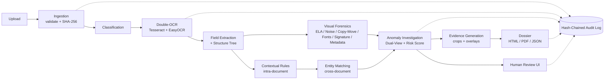

# 🕵️ DocDetective: AI-Powered Document Forensics & Contextual Intelligence System

> **Don't just extract text. Show, with evidence, what in a document looks suspicious and why.**

Built for the **DataOps Innovation Hackathon 2026**.


> ⚠️ **Notice:** This project must be used **only with synthetic or explicitly authorized documents**. Do not upload real customer or personal data. Automated findings are **indicators for human review, not conclusions of fraud.**

---

## 📑 Table of Contents

1. [What is DocDetective?](#-what-is-docdetective)
2. [Key Features](#-key-features)
3. [Innovation Highlights](#-innovation-highlights)
4. [Pipeline Overview](#-pipeline-overview)
5. [Architecture](#-architecture)
6. [Tech Stack](#-tech-stack)
7. [Prerequisites](#-prerequisites)
8. [Quick Start (Docker)](#-quick-start-docker)
9. [Manual Setup](#-manual-setup)
10. [Configuration](#-configuration)
11. [Generate the Demo Dataset](#-generate-the-demo-dataset)
12. [Run the Demo](#-run-the-demo)
13. [Tests & Evaluation](#-tests--evaluation)
14. [Project Structure](#-project-structure)
15. [API Overview](#-api-overview)
16. [Capability Matrix](#-capability-matrix)
17. [Limitations & Known False Positives](#-limitations--known-false-positives)
18. [Safety, Ethics & Security](#-safety-ethics--security)
19. [Standards & References](#-standards--references)
20. [Licensing](#-licensing)
21. [Team](#-team)

---

## 🔍 What is DocDetective?

Traditional document systems use OCR to read text and rules to validate individual fields. But **reading a document is not the same as trusting it.** Documents can contain altered digits, overwritten fields, pasted signatures, or details that only look wrong when *several documents are compared together*.

**DocDetective** takes multiple related documents for a single case (ID card, application form, bank statement, salary slip, utility bill, declaration) and:

1. Extracts structured data with confidence scores
2. Understands layout and field relationships
3. Detects visual tampering
4. Checks consistency **inside** each document
5. Correlates information **across** documents
6. Explains every anomaly with evidence from both sides (suspicious and innocent)
7. Produces a professional **Investigation Dossier** backed by a tamper-evident audit trail

---

## ✨ Key Features

| Area | What it does |
|---|---|
| **Ingestion** | Multi-file upload (JPG, PNG, TIFF, PDF), magic-byte validation, SHA-256 hashing of originals |
| **Classification** | Hybrid keyword/layout heuristics (+ optional LLM zero-shot) with reasons for each decision |
| **Double-OCR** | Tesseract + EasyOCR fused at word level; disagreement is flagged as low reliability |
| **Structured Extraction** | Field-level JSON with value, confidence, OCR agreement, bounding box, source document |
| **Structure Understanding** | Document tree (sections → fields → words); detects missing, duplicated and misplaced fields |
| **Visual Forensics** | ELA, noise-residual analysis, copy-move detection, font/stroke/baseline outliers, whitening/overwrite detection, metadata checks |
| **Signature Analysis** | Signature detection, cross-document similarity, placement and paste-edge checks |
| **Contextual Verification** | DOB vs age, totals vs line items, balance reconciliation, date logic, ID format validity |
| **Cross-Document Correlation** | Fuzzy + phonetic entity matching for names, DOB, addresses, IDs, accounts, employers |
| **Evidence Mapping** | Every finding links to document, page, bounding box, crop image and extracted field |
| **Dossier** | HTML, PDF and JSON reports with all required sections (7.1 to 7.6) |
| **Audit Trail** | Hash-chained, verifiable log of every event |
| **Human Review** | Confirm, dismiss or request more info on each finding, with notes |

---

## 💡 Innovation Highlights

### 1. ⚖️ Dual-View Reasoning
Every anomaly gets **two explanations**:
- 🔴 **Why it may be manipulated** (cites evidence IDs)
- 🟢 **Why it may be innocent** (scan quality, JPEG compression, different printer, abbreviation, OCR error, re-issued document)

Findings are placed on a **three-level risk ladder**, and nothing is ever labelled "fraud":

```
OBSERVED  →  INCONSISTENT  →  POTENTIAL_MANIPULATION
 (grey)         (amber)              (red)
```

Risk scoring is **explainable**: the weights and formula are shown for each finding, and the LLM (or template) only *phrases* the result.

### 2. 🕸️ Cross-Document Relationship Graph
Documents, entities (person, address, account, ID) and fields are nodes. Edges are:
- 🟢 **green** = exact match
- 🟡 **amber** = tolerated variation (e.g. "Rahul K. Sharma" vs "Rahul Kumar Sharma")
- 🔴 **red** = true conflict

Click any edge to open the underlying evidence.

### 3. 🔐 Hash-Chained Audit Trail
Each event stores `{event_id, timestamp, actor, action, payload_hash, prev_hash, entry_hash}` where
`entry_hash = SHA-256(prev_hash + canonical_event_json)`.
Use **Verify Integrity** in the UI (or `/audit/verify`) to confirm the chain. A demo script edits one DB row to show verification failing.

### 4. 🔁 Double-OCR Reliability Check
Two independent OCR engines run on every page. Where they disagree, the field is flagged "low reliability". OCR output is never treated as ground truth.

### 5. 🧑‍⚖️ Human-in-the-Loop Review
Reviewers mark findings as **Confirmed / Dismissed / Needs more info**. Every action is logged in the audit chain and reflected in the dossier. Each finding also includes a concrete **"Next Verification" step**.

---

## 🔄 Pipeline Overview

```
Submission → Classification → OCR & Extraction → Structural Understanding
   → Visual Forensics → Contextual Verification → Cross-Document Correlation
   → Anomaly Investigation → Evidence Generation → Investigation Dossier
```

Each step runs as a background job and streams live progress to the UI.

Every finding is categorized into one of three clearly separate types:

| Type | Meaning | Example |
|---|---|---|
| **Observed** | Neutral visual fact | "Text height of '8' is 22% larger than neighbouring digits" |
| **Detected Inconsistency** | A rule or comparison failed | "Closing balance does not match transactions" |
| **Potential Manipulation** | Interpretation, always with caveats | "Digit may have been edited; verify against the original" |

---

## 🏗️ Architecture

The full diagram is in [`docs/ARCHITECTURE.md`](docs/ARCHITECTURE.md). High-level view:



---

## 🧰 Tech Stack

| Layer | Technologies |
|---|---|
| **Backend** | Python 3.11, FastAPI, Uvicorn, SQLAlchemy, SQLite, Pydantic |
| **Documents** | PyMuPDF, Pillow, OpenCV, NumPy, scikit-image |
| **OCR** | Tesseract (pytesseract), EasyOCR |
| **NLP / Matching** | spaCy, rapidfuzz, dateparser, jellyfish |
| **Forensics** | ELA, noise residuals, ORB/SIFT + RANSAC, SSIM, Hu moments |
| **LLM (optional)** | Anthropic Claude / OpenAI / local Ollama, with deterministic template fallback |
| **Graph** | networkx, Cytoscape.js |
| **Frontend** | React, Vite, TailwindCSS |
| **Reports** | Jinja2, WeasyPrint / ReportLab |
| **Packaging** | Docker, docker-compose, Makefile |

> The app works **fully offline with no API key**. The LLM only improves the wording of explanations and can never invent evidence.

---

## 📋 Prerequisites

- **Python** 3.11+
- **Node.js** 18+ and npm
- **Tesseract OCR** installed and on your `PATH`
  - Ubuntu/Debian: `sudo apt install tesseract-ocr`
  - macOS: `brew install tesseract`
  - Windows: install from the [UB Mannheim builds](https://github.com/UB-Mannheim/tesseract/wiki) and add to PATH
- **Docker** and **docker-compose** (only for the Docker route)
- ~4 GB free disk space (EasyOCR and spaCy models)
- No GPU required

---

## 🐳 Quick Start (Docker)

```bash
git clone https://github.com/<your-username>/docdetective.git
cd docdetective

docker-compose up --build
```

Then open:
- **App UI:** http://localhost:5173
- **API docs (Swagger):** http://localhost:8000/docs

No API key is needed.

---

## 🛠️ Manual Setup

### Backend

```bash
cd backend
python -m venv .venv
source .venv/bin/activate          # Windows: .venv\Scripts\activate
pip install -r requirements.txt
python -m spacy download en_core_web_sm

cp .env.example .env               # optional: add LLM keys
uvicorn app.main:app --reload --port 8000
```

### Frontend

```bash
cd frontend
npm install
npm run dev                        # runs on http://localhost:5173
```

### Using Make

```bash
make setup      # install everything
make dataset    # generate demo documents
make run        # start backend + frontend
make test       # run unit tests
make eval       # run evaluation against ground truth
```

---

## ⚙️ Configuration

Set these in `backend/.env` (all optional):

| Variable | Default | Description |
|---|---|---|
| `LLM_PROVIDER` | `none` | `none`, `anthropic`, `openai`, or `ollama` |
| `ANTHROPIC_API_KEY` | none | Required if provider is `anthropic` |
| `OPENAI_API_KEY` | none | Required if provider is `openai` |
| `OLLAMA_URL` | `http://localhost:11434` | Local Ollama endpoint |
| `MAX_UPLOAD_MB` | `25` | Maximum size per file |
| `DATA_DIR` | `./storage` | Where originals and evidence are stored (outside web root) |
| `ENCRYPT_AT_REST` | `false` | Enable optional encryption of stored files |
| `RETENTION_DAYS` | `30` | Auto-delete window for case data (audit events are kept) |
| `CORS_ORIGINS` | `http://localhost:5173` | Allowed frontend origins |

> With `LLM_PROVIDER=none`, explanations are produced by deterministic templates.

---

## 🧪 Generate the Demo Dataset

All demo documents are **100% synthetic** (fake names, IDs and signatures).

```bash
python data/generate_dataset.py
```

This creates:

| Folder | Contents |
|---|---|
| `data/demo_case_genuine/` | Consistent ID card, loan form, 3-month bank statement, salary slip, utility bill, signed declaration, with harmless variations such as "Rahul K. Sharma" vs "Rahul Kumar Sharma" |
| `data/demo_case_tampered/` | Same set with injected manipulations, plus `manipulations.json` ground truth |

**Injected manipulations (tampered set):**

| # | Manipulation |
|---|---|
| a | Amount digit changed in salary slip |
| b | DOB altered on ID vs application form |
| c | Pasted or whitened-over field on bank statement |
| d | Copy-moved stamp/seal |
| e | Foreign signature pasted onto declaration |
| f | Closing balance does not match transactions |
| g | Address mismatch between utility bill and application |
| h | PDF with edited metadata (ModDate after CreationDate, editor tag) |

**Hard negatives:** genuine documents with heavy compression or blur, which should *not* be flagged as manipulation (at most "Observed").

---

## 🎬 Run the Demo

1. Start the app (Docker or manual).
2. Open http://localhost:5173.
3. Follow [`DEMO_SCRIPT.md`](DEMO_SCRIPT.md), which walks through:

| Step | What to show |
|---|---|
| 1 | Upload multiple documents and watch the pipeline progress |
| 2 | Classification and double-OCR extraction |
| 3 | Structured JSON output with confidence and OCR agreement |
| 4 | Highlighted suspicious regions with toggleable overlays (ELA, noise, signature) |
| 5 | Intra-document inconsistencies |
| 6 | Cross-document conflicts |
| 7 | Relationship graph (green / amber / red edges) |
| 8 | Inspect evidence and the dual-view explanation of a finding |
| 9 | Generate the dossier (PDF/JSON) |
| 10 | Trace a finding back to its exact source location |
| 11 | Show the Observed vs Potential distinction |
| 12 | Upload an unsupported file to show safe failure handling |
| 13 | Verify the audit chain, then run the tamper script and show it fail |

**Audit tamper demo:**
```bash
python scripts/tamper_audit_demo.py     # edits one DB row
# then click "Verify Integrity" in the UI → chain reports BROKEN
```

---

## ✅ Tests & Evaluation

```bash
cd backend
pytest -v
```

Unit tests cover: hash chain, entity matching, OCR fusion and each forensic detector.

```bash
python data/evaluate.py
```

Runs the pipeline on the tampered case and prints **precision and recall per manipulation type** against `manipulations.json`.

> Results are reported honestly, including misses and false positives. See [`docs/LIMITATIONS.md`](docs/LIMITATIONS.md).

### Evaluation Results

*(Fill in after running `evaluate.py`.)*

| Manipulation | Detected? | Precision | Recall | Notes |
|---|---|---|---|---|
| a. Digit change | | | | |
| b. DOB mismatch | | | | |
| c. Whitened field | | | | |
| d. Copy-moved stamp | | | | |
| e. Pasted signature | | | | |
| f. Balance mismatch | | | | |
| g. Address mismatch | | | | |
| h. Metadata edit | | | | |

---

## 📂 Project Structure

```
docdetective/
├── backend/
│   ├── app/
│   │   ├── api/              # routers: cases, documents, findings, graph, dossier, audit
│   │   ├── core/             # config, logging, security
│   │   ├── ingestion/        # validation, normalization, SHA-256, IDs
│   │   ├── classification/   # document type classifier
│   │   ├── ocr/              # tesseract, easyocr, fusion
│   │   ├── extraction/       # layout, key-value fields, tables, schema
│   │   ├── forensics/        # ela, noise, copymove, fonts, alignment, background, metadata, signature
│   │   ├── context/          # intra-document rules
│   │   ├── correlation/      # entity matching, cross-doc, graph builder
│   │   ├── reasoning/        # dual_view, risk_levels, llm_provider, templates
│   │   ├── evidence/         # evidence objects, bbox mapping, crops/overlays
│   │   ├── audit/            # hash_chain, verify
│   │   ├── dossier/          # builder, Jinja2 templates, PDF export
│   │   └── models/           # SQLAlchemy + Pydantic schemas
│   └── tests/
├── frontend/
│   └── src/
│       ├── pages/            # Upload, CaseDashboard, DocumentViewer, FindingsReview,
│       │                     # RelationshipGraph, Dossier, AuditTrail
│       └── components/       # BBoxOverlay, ConfidenceBadge, ProgressStepper,
│                             # FindingCard, DualViewPanel, EvidenceCrop
├── data/                     # dataset generator, demo cases, evaluate.py
├── docs/                     # architecture, technical docs, limitations, capability matrix
├── scripts/                  # audit tamper demo, utilities
├── README.md
├── DEMO_SCRIPT.md
├── LICENSE
├── Dockerfile
├── docker-compose.yml
└── Makefile
```

---

## 🔌 API Overview

Full interactive docs at `/docs` (Swagger).

| Method | Endpoint | Purpose |
|---|---|---|
| `POST` | `/cases` | Create a new investigation case |
| `POST` | `/cases/{id}/documents` | Upload one or more documents |
| `GET` | `/cases/{id}/progress` | Live pipeline progress (SSE) |
| `GET` | `/documents/{id}` | Document metadata and extracted fields |
| `GET` | `/documents/{id}/pages/{n}` | Page image with optional overlays |
| `GET` | `/cases/{id}/findings` | List findings (filter by risk, type, document) |
| `PATCH` | `/findings/{id}/review` | Confirm / Dismiss / Needs more info, with notes |
| `GET` | `/cases/{id}/graph` | Relationship graph (nodes and edges) |
| `POST` | `/cases/{id}/dossier` | Generate dossier |
| `GET` | `/cases/{id}/dossier.pdf` / `.json` | Download dossier |
| `GET` | `/audit` | Audit log |
| `GET` | `/audit/verify` | Verify hash-chain integrity |
| `DELETE` | `/cases/{id}` | Delete case data (audit event retained) |

---

## 📊 Capability Matrix

Update this table honestly before submission. Detailed version in [`docs/CAPABILITY_MATRIX.md`](docs/CAPABILITY_MATRIX.md).

| Capability | Status |
|---|---|
| Multi-document ingestion (JPG/PNG/TIFF/PDF) | ☐ Implemented / ☐ Partial |
| Document classification | ☐ Implemented / ☐ Partial |
| Double-OCR with confidence | ☐ Implemented / ☐ Partial |
| Structured field extraction | ☐ Implemented / ☐ Partial |
| Table and total detection | ☐ Implemented / ☐ Partial |
| Handwriting recognition | ☐ Partial (best-effort) / ☐ Unsupported |
| Multilingual documents | ☐ Planned / ☐ Unsupported |
| ELA / noise / copy-move detection | ☐ Implemented / ☐ Partial |
| Font and baseline consistency | ☐ Implemented / ☐ Partial |
| Signature analysis | ☐ Implemented / ☐ Partial |
| Metadata forensics | ☐ Implemented / ☐ Partial |
| Intra-document rules | ☐ Implemented / ☐ Partial |
| Cross-document correlation and graph | ☐ Implemented / ☐ Partial |
| Dual-view reasoning | ☐ Implemented / ☐ Partial |
| Evidence mapping and traceability | ☐ Implemented / ☐ Partial |
| Dossier (HTML / PDF / JSON) | ☐ Implemented / ☐ Partial |
| Hash-chained audit trail | ☐ Implemented / ☐ Partial |
| Human review workflow | ☐ Implemented / ☐ Partial |

---

## ⚠️ Limitations & Known False Positives

Full list in [`docs/LIMITATIONS.md`](docs/LIMITATIONS.md). Highlights:

- **Heavy JPEG compression or re-saving** can trigger ELA and noise detectors (false positives).
- **Handwriting OCR is weak**, and results are labelled "low reliability".
- **Non-English and mixed-script documents** are not fully supported.
- **Low-resolution or skewed scans** reduce font and alignment analysis accuracy.
- **Legitimate re-issued documents** may differ from older records and appear as conflicts.
- **Signature similarity** varies naturally between genuine signings.
- **AI-generated or high-quality forgeries** may evade classical forensics.
- Detectors are heuristic and trained or tuned on **synthetic data only**, so real-world accuracy is unknown.
- If a detector fails, the document is marked **"Not analyzed: reason"** rather than silently skipped.

---

## 🛡️ Safety, Ethics & Security

- **Authorized data only.** The repo ships with synthetic documents.
- **No fraud labels.** The system reports potential anomalies with evidence and confidence.
- **OCR is not ground truth.** Disagreement between engines is surfaced.
- **Human oversight.** Consequential decisions stay with a human reviewer.
- **Prompt-injection defense.** Text extracted from documents is treated as untrusted, delimited in LLM prompts, and the model is instructed to ignore instructions inside documents. The LLM may cite only provided evidence IDs.
- **Upload hardening.** MIME and magic-byte checks, size limits, no execution of uploaded content.
- **Sensitive data.** ID and account numbers are masked in logs; originals are stored outside the web root; optional encryption at rest; delete-case endpoint.
- **Auditability.** All actions are recorded in a tamper-evident chain.
- **OWASP ML Top 10** considerations (e.g. input manipulation, prompt injection) are discussed in `docs/TECHNICAL_DOCS.md`.

---

## 📚 Standards & References

Used as guidance only. **This project does not claim formal compliance** with any of them.

- ISO/IEC 27037: identification, collection, acquisition and preservation of digital evidence
- ISO/IEC 27041: suitability and adequacy of investigative methods
- ISO/IEC 27042: analysis and interpretation of digital evidence
- NIST SP 800-86: integrating forensic techniques into incident response
- OWASP Machine Learning Security Top 10

---

## 📜 Licensing

This project is released under the **MIT License** (see [`LICENSE`](LICENSE)).

Third-party dependencies keep their own licenses. Please verify before commercial use:

| Dependency | License (verify) |
|---|---|
| Tesseract | Apache 2.0 |
| EasyOCR | Apache 2.0 |
| OpenCV | Apache 2.0 |
| PyMuPDF | AGPL-3.0 / commercial |
| FastAPI | MIT |
| spaCy | MIT |
| rapidfuzz | MIT |
| networkx | BSD-3 |
| React, Vite | MIT |
| WeasyPrint | BSD-3 |

> **Note:** PyMuPDF is AGPL-licensed. Review this if you plan to distribute the project commercially.

---

## 👥 Team

| Name | Role |
|---|---|
| Priyanshu Kumar | Developer |

**Hackathon:** DataOps Innovation Hackathon 2026
**Problem Statement:** AI-Powered Document Forensics and Contextual Intelligence System

---

> *"Automated findings are indicators for human review, not conclusions of fraud."*
